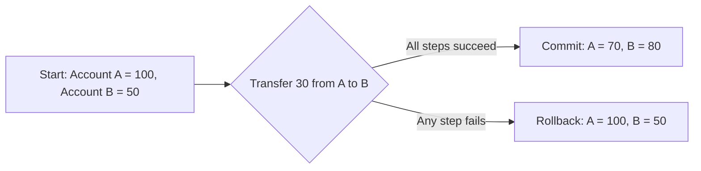

# ACID Properties

## Diagram

## Explained in 5 lines
1. **Atomicity**: a transaction is all-or-nothing. If any step fails, everything is undone.
2. **Consistency**: a transaction moves the database from one valid state to another, and rules like constraints always hold.
3. **Isolation**: transactions running at the same time don't see each other's half-finished work.
4. **Durability**: once committed, the data survives crashes and power cuts because it is saved to disk and logs.
5. Together they make sure money transfers, orders and bookings never end up half done or corrupted.

## Common interview questions
- What does ACID stand for? Explain each property with an example.
- What happens if the system crashes in the middle of a transaction?
- How is isolation achieved? (locks, MVCC)
- What are isolation levels?
- What is the difference between Atomicity and Durability?

## Revision cheat-line
> Atomicity = all or nothing. Consistency = rules always hold. Isolation = no peeking. Durability = saved forever.
