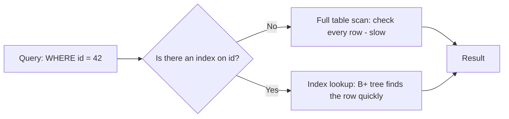

# Indexing: Why Queries Get Fast

## Diagram

## Explained in 5 lines
1. An **index** is like the index at the back of a book. Instead of reading every page, you jump straight to the right one.
2. Most databases store indexes as a **B+ tree**, so finding a row takes a handful of steps instead of scanning millions of rows.
3. Indexes make **reads fast** but **writes slower** (every insert, update or delete must also update the index) and they use extra storage.
4. A **primary key** is indexed automatically. Add indexes on columns you often use in `WHERE`, `JOIN` and `ORDER BY`.
5. A **composite index** on `(a, b)` helps queries that filter on `a`, or on `a` and `b`, but usually not on `b` alone (the leftmost-prefix rule).

## Common interview questions
- What is an index and how does it speed up queries?
- Clustered vs non-clustered index?
- Why B+ tree and not a binary tree or hash table?
- What are the downsides of too many indexes?
- What is the leftmost-prefix rule?

## Revision cheat-line
> Index = book index. Fast to find, but you must keep it updated every time the book changes.
