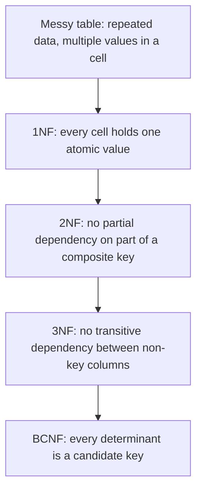

# Normalization (1NF to BCNF)

## Diagram

## Explained in 5 lines
1. Normalization organizes tables to remove **redundancy** (repeated data) and avoid update, insert and delete **anomalies**.
2. **1NF**: each cell has a single value, with no lists like "Maths, Physics" in one cell.
3. **2NF**: already in 1NF, and every non-key column depends on the **whole** primary key, not just part of it.
4. **3NF**: already in 2NF, and non-key columns depend only on the key, not on other non-key columns (for example, `student_id -> city -> pincode` is a transitive chain).
5. **BCNF** is a stricter 3NF. Whenever `X -> Y` holds, X must be a candidate key.

## Common interview questions
- What is normalization and why is it needed?
- What are insertion, update and deletion anomalies?
- Explain 1NF, 2NF, 3NF and BCNF with examples.
- What is functional dependency?
- What is denormalization and when would you use it?

## Revision cheat-line
> "The key, the whole key, and nothing but the key, so help me Codd."
