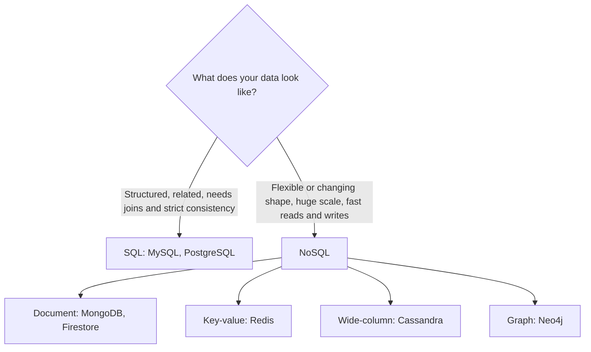

# SQL vs NoSQL: How to Choose

## Diagram

## Explained in 5 lines
1. **SQL** (relational) databases store data in tables with a fixed schema and use SQL for queries and joins.
2. **NoSQL** databases store data in flexible formats (documents, key-value pairs, graphs) and usually scale out across many servers more easily.
3. SQL is a strong fit for banking, orders and inventory, where relationships and **ACID** guarantees matter.
4. NoSQL is a strong fit for real-time apps, caching, logs, social feeds and data whose structure keeps changing.
5. It's not either/or. Many real systems use both, for example SQL for payments and Redis for caching.

## Common interview questions
- Difference between SQL and NoSQL?
- When would you choose NoSQL over SQL?
- What is the CAP theorem?
- What are the types of NoSQL databases?
- What are BASE properties?

## Revision cheat-line
> SQL = strict spreadsheet with rules. NoSQL = flexible folders of notes that scale out easily.
