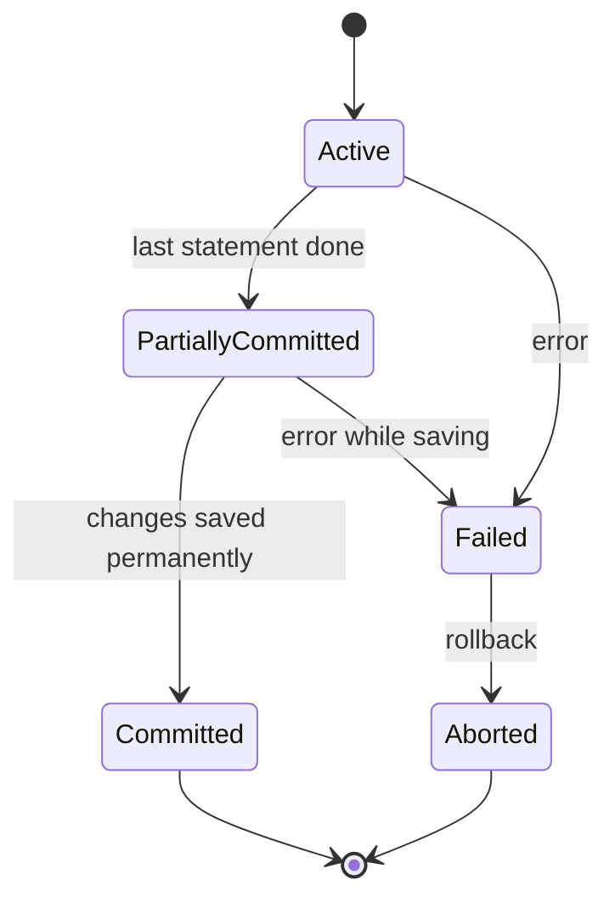

# Transactions and Isolation Levels

## Diagram

## Explained in 5 lines
1. A **transaction** is a group of SQL steps treated as one unit: `BEGIN`, then your statements, then `COMMIT` (save) or `ROLLBACK` (undo).
2. When many transactions run together, problems can appear: **dirty read** (reading uncommitted data), **non-repeatable read** (the same row changes between two reads) and **phantom read** (new rows appear between two reads).
3. **Isolation levels** control how strictly transactions are kept apart. Stricter means safer but slower.
4. The four standard levels, from weakest to strongest:

| Level | Dirty read | Non-repeatable read | Phantom read |
|---|---|---|---|
| Read Uncommitted | possible | possible | possible |
| Read Committed | prevented | possible | possible |
| Repeatable Read | prevented | prevented | possible |
| Serializable | prevented | prevented | prevented |

5. Real databases differ in details (for example, PostgreSQL's Repeatable Read also blocks phantoms, and MySQL InnoDB defaults to Repeatable Read), so always check the docs.

## Common interview questions
- What is a transaction? What are COMMIT, ROLLBACK and SAVEPOINT?
- What are dirty, non-repeatable and phantom reads?
- Explain the four isolation levels.
- How do locks and MVCC provide isolation?
- Which isolation level would you use for a banking app?

## Revision cheat-line
> Higher isolation = fewer weird reads, but slower. Serializable = transactions behave as if they ran one by one.
