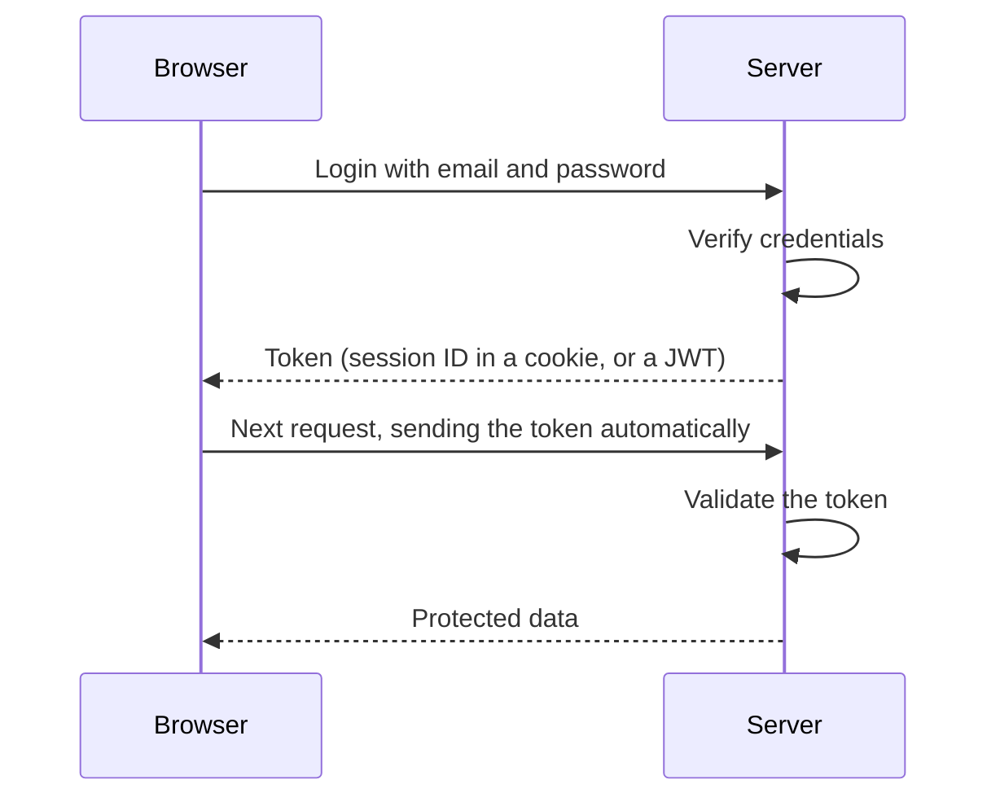

# Cookies vs Sessions vs JWT

## Diagram

## Explained in 5 lines
1. HTTP forgets you after every request (it is *stateless*), so websites need a way to remember who you are.
2. A **cookie** is a small piece of data the browser stores and sends back to the server with each request.
3. A **session** keeps your data on the **server**. The cookie holds only a session ID, so the server looks you up each time.
4. A **JWT** (JSON Web Token) is a signed token that carries your data inside it. The server just verifies the signature, so it needs no session storage (*stateless*).
5. Sessions are easy to revoke but need server memory. JWTs scale well but are harder to revoke before they expire, and should never contain secrets.

## Common interview questions
- Difference between cookies and sessions?
- What is a JWT and what are its three parts (header, payload, signature)?
- Session-based vs token-based authentication?
- Where should you store a JWT, and what are the risks (XSS, CSRF)?
- What is OAuth?

## Revision cheat-line
> Session = the club keeps your name on a list. JWT = you carry a signed wristband.
