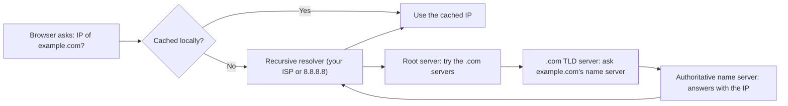

# How DNS Works

## Diagram

## Explained in 5 lines
1. **DNS** (Domain Name System) is the internet's phonebook. It turns names like `example.com` into IP addresses that computers use.
2. Your browser and OS check their **cache** first. If the answer isn't there, a **recursive resolver** does the hard work for you.
3. The resolver asks the **root server**, which points to the **TLD server** (`.com`, `.in`), which points to the **authoritative name server** that holds the real answer.
4. The answer is cached everywhere along the way for a time set by the **TTL**, so later lookups are fast.
5. Common record types: **A** (name to IPv4), **AAAA** (IPv6), **CNAME** (alias to another name), **MX** (mail servers), **NS** (name servers), **TXT** (text, often for verification).

## Common interview questions
- What is DNS and why do we need it?
- Explain the steps of a DNS lookup.
- Recursive vs iterative queries?
- What are A, CNAME, MX and NS records?
- What is TTL, and why does DNS use UDP (port 53)?

## Revision cheat-line
> DNS = the phonebook of the internet: you know the name, it finds the number.
