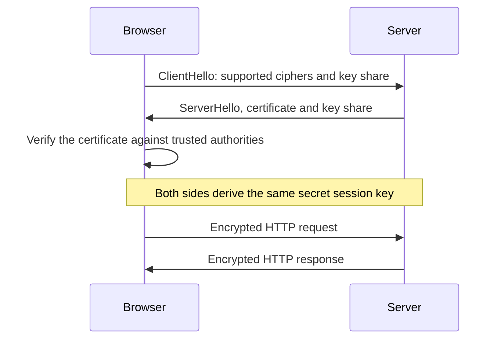

# HTTP vs HTTPS (and How TLS Works)

## Diagram

## Explained in 5 lines
1. **HTTP** sends data as plain text on port 80, so anyone on the network path can read or change it.
2. **HTTPS** is HTTP wrapped in **TLS**: the data is encrypted, can't be tampered with unnoticed, and the server proves its identity. It uses port 443.
3. During the **TLS handshake** the browser checks the server's **certificate**, issued by a trusted Certificate Authority, to confirm it's the real site.
4. **Asymmetric** cryptography (public and private keys) is used to agree on a secret key safely. Then fast **symmetric** encryption (one shared key) protects the actual data.
5. HTTPS protects against eavesdropping and man-in-the-middle attacks. It doesn't mean the website itself is trustworthy.

## Common interview questions
- Difference between HTTP and HTTPS?
- What happens in a TLS handshake?
- Symmetric vs asymmetric encryption?
- What is an SSL/TLS certificate and who issues it?
- What is a man-in-the-middle attack?

## Revision cheat-line
> HTTP = postcard anyone can read. HTTPS = sealed envelope, with a verified sender.
