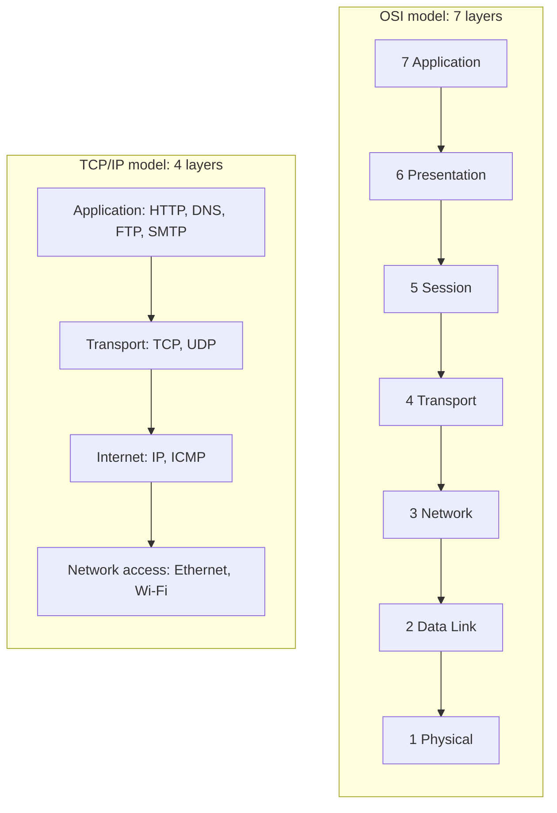

# OSI Model vs TCP/IP Model

## Diagram

## Explained in 5 lines
1. The **OSI model** is a 7-layer reference model that explains how data travels across a network. It's mainly used for learning and troubleshooting.
2. The **TCP/IP model** is the 4-layer model that the real internet actually uses.
3. OSI layers 5 to 7 (Session, Presentation, Application) are merged into the TCP/IP **Application** layer.
4. OSI layers 1 and 2 (Physical, Data Link) are merged into TCP/IP **Network access**.
5. Remember OSI top to bottom with: **A**ll **P**eople **S**eem **T**o **N**eed **D**ata **P**rocessing.

## Common interview questions
- Name the 7 layers of the OSI model and what each one does.
- Difference between the OSI and TCP/IP models?
- At which layer do routers, switches and hubs work?
- Which protocols belong to which layer?
- What is encapsulation?

## Revision cheat-line
> OSI is the textbook with 7 chapters. TCP/IP is the 4-chapter version the internet really runs on.
