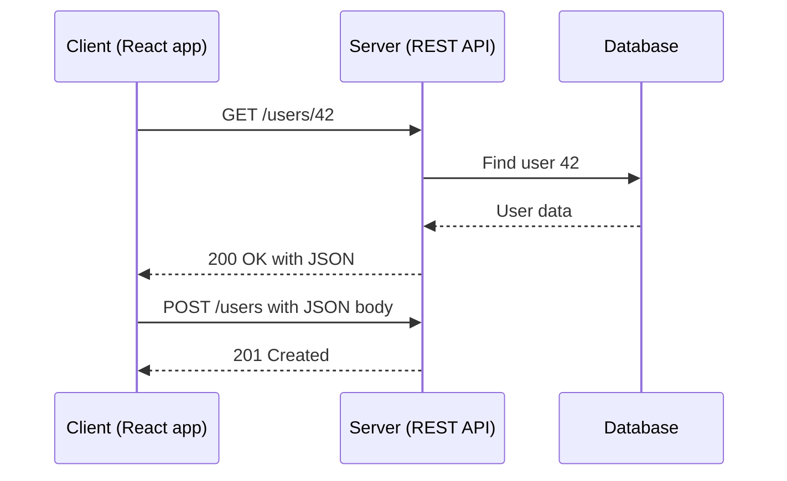

# REST API Basics

## Diagram

## Explained in 5 lines
1. A **REST API** lets programs talk over HTTP. Each thing (a *resource*) like `/users/42` has its own URL.
2. You act on resources with HTTP methods: **GET** (read), **POST** (create), **PUT** (replace), **PATCH** (partial update), **DELETE** (remove).
3. REST is **stateless**: every request carries everything the server needs, and the server remembers nothing between requests.
4. Servers answer with **status codes**: 200 OK, 201 Created, 400 Bad Request, 401 Unauthorized, 403 Forbidden, 404 Not Found, 500 Server Error. Data usually comes back as **JSON**.
5. **GET, PUT and DELETE are idempotent** (repeating them gives the same result). **POST is not**, because repeating it can create duplicates.

## Common interview questions
- What is REST? What makes an API RESTful?
- PUT vs PATCH? PUT vs POST?
- What does idempotent mean?
- 401 vs 403?
- REST vs GraphQL?
- How do you version and secure an API?

## Revision cheat-line
> REST = URLs are nouns, HTTP methods are verbs, and the server remembers nothing between calls.
