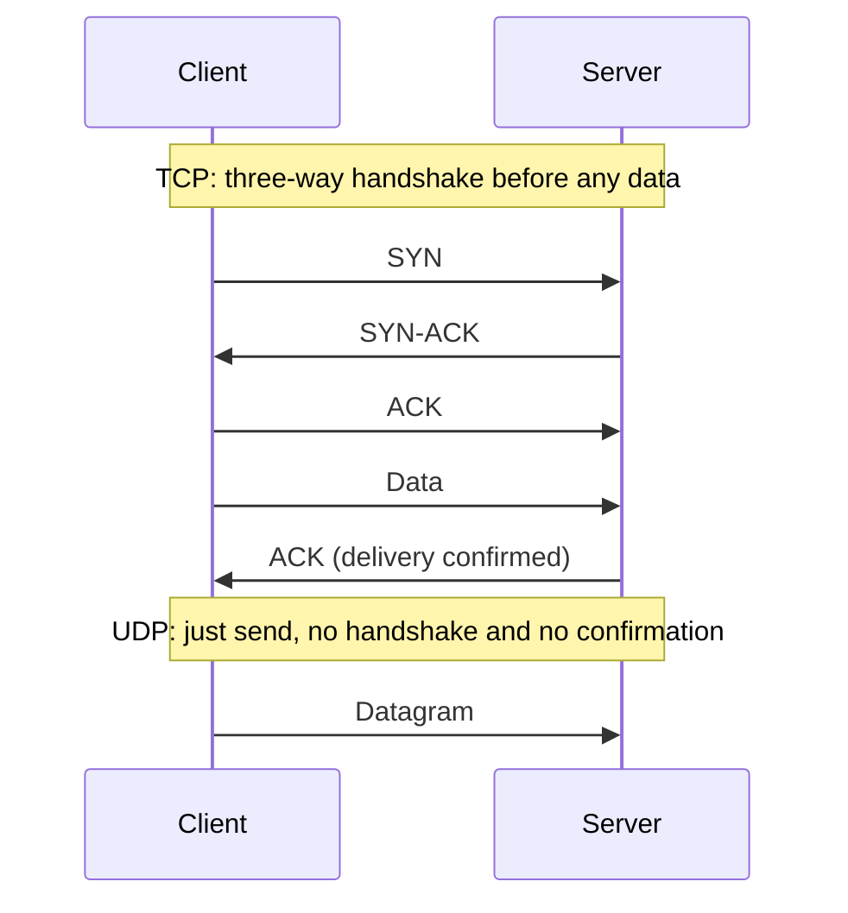

# TCP vs UDP

## Diagram

## Explained in 5 lines
1. **TCP** is connection-based. It sets up a connection, numbers the data, resends lost packets, and keeps order. It's reliable but slower.
2. **UDP** is connectionless. It just sends packets with no guarantee of delivery or order. It's fast and lightweight.
3. TCP is used for web pages (HTTP/HTTPS), email, file transfer and SSH, where every byte must arrive.
4. UDP is used for video calls, live streaming, online games and DNS, where speed matters more than perfection.
5. TCP also does **flow control** and **congestion control**, while UDP does neither.

## Common interview questions
- Difference between TCP and UDP?
- Explain the TCP three-way handshake.
- Why does DNS mostly use UDP?
- How does TCP guarantee reliable delivery?
- What are flow control and congestion control?

## Revision cheat-line
> TCP = registered post with tracking. UDP = dropping a postcard in the box.
