# What Happens When You Type a URL in the Browser?

## Diagram

```mermaid
flowchart LR
    A["1. You type a URL and press Enter"] --> B["2. Browser checks its cache"]
    B --> C["3. DNS lookup: domain name to IP address"]
    C --> D["4. TCP connection (three-way handshake)"]
    D --> E["5. TLS handshake for HTTPS"]
    E --> F["6. Browser sends an HTTP request"]
    F --> G["7. Server processes it and sends an HTTP response"]
    G --> H["8. Browser renders HTML, CSS and JS"]
```

## Explained in 5 lines
1. The browser first checks if it already knows the IP address or has the page cached.
2. If not, it asks **DNS** to turn the domain name (like `example.com`) into an IP address.
3. It opens a **TCP connection** to that IP, and for HTTPS it also does a **TLS handshake** to encrypt the traffic.
4. It sends an **HTTP request** (for example `GET /`), and the server (often behind a load balancer) replies with a status code and the page.
5. The browser reads the HTML, fetches the CSS, JS and images, builds the page (DOM and CSSOM) and paints it on the screen.

## Common interview questions
- What happens when you type google.com in a browser and press Enter?
- What is DNS and how does a lookup work?
- What is the role of TCP and TLS here?
- What are HTTP status codes like 200, 301, 404 and 500?
- How does the browser render a page?

## Revision cheat-line
> Name to IP (DNS), connect (TCP), secure it (TLS), ask (HTTP), draw (render).
