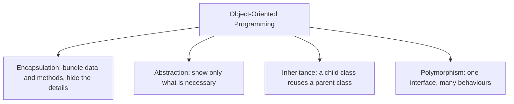

# The 4 Pillars of OOP

## Diagram

## Explained in 5 lines
1. **Encapsulation**: wrap data and the methods that use it in one class, and protect it (private fields with getters and setters), like a capsule.
2. **Abstraction**: expose *what* something does and hide *how*. You press the car pedal without knowing the engine internals.
3. **Inheritance**: `Dog` can inherit from `Animal` and reuse its code, which supports an "is-a" relationship.
4. **Polymorphism**: the same method name behaves differently depending on the object (`speak()` is a bark for `Dog` and a meow for `Cat`).
5. Together they give code that is reusable, organized, secure and easier to change.

## Common interview questions
- What are the four pillars of OOP? Explain each with an example.
- Abstraction vs encapsulation?
- Compile-time vs run-time polymorphism?
- Why is multiple inheritance risky (the diamond problem)?
- Class vs object?

## Revision cheat-line
> A-PIE: Abstraction, Polymorphism, Inheritance, Encapsulation.
