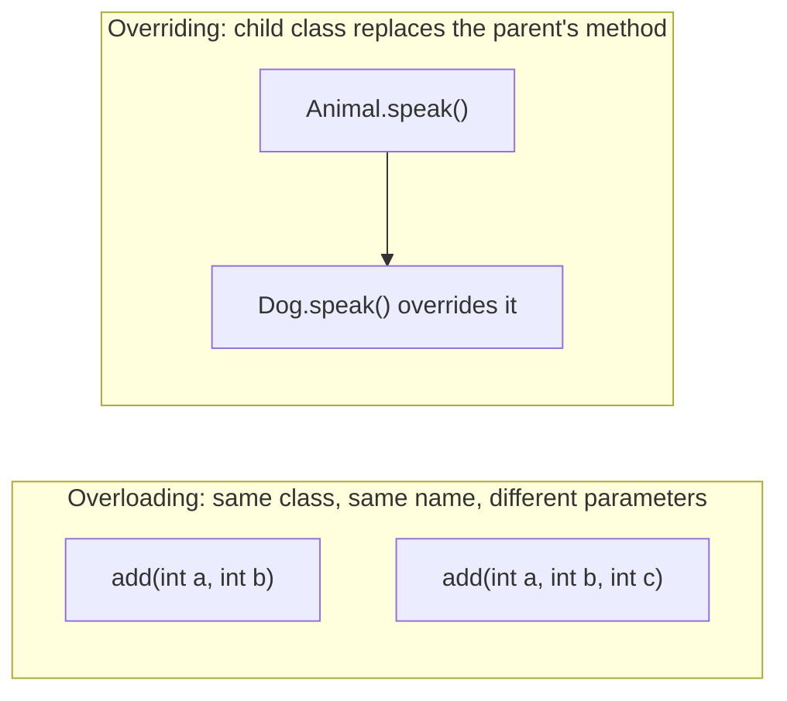

# Method Overloading vs Overriding

## Diagram


## Explained in 5 lines
1. **Overloading** means several methods with the **same name but different parameters** in the same class. It's resolved at **compile time** (compile-time polymorphism).
2. **Overriding** means a child class gives its **own version** of a method already defined in the parent, with the same name and parameters. It's resolved at **run time** (run-time polymorphism).
3. Overloading needs different parameter lists. Return type alone is not enough.
4. Overriding needs inheritance. In Java you can mark it with `@Override`.
5. Python has no true overloading (the last definition wins), but you can use default arguments. It does support overriding:

```python
class Animal:
    def speak(self):
        return "Some sound"

class Dog(Animal):
    def speak(self):          # overriding
        return "Woof"

print(Dog().speak())  # Woof
```

## Common interview questions
- Difference between overloading and overriding?
- Which one is compile-time and which is run-time polymorphism?
- Can we overload `main()` in Java? Can we override a static method?
- What is the `super` keyword used for?
- What are virtual functions?

## Revision cheat-line
> Overload = same name, different inputs. Override = same name, new behaviour in the child.
