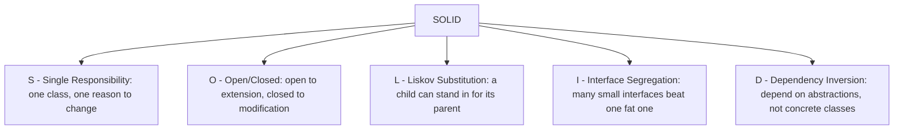

# SOLID Principles

## Diagram


## Explained in 5 lines
1. **S**: a class should do one job. A `Report` class shouldn't also send emails and save to the database.
2. **O**: add new behaviour by adding new code (a new subclass), not by editing old, tested code.
3. **L**: if `Bird` has `fly()`, a `Penguin` that can't fly breaks the rule. Subclasses must behave properly wherever the parent is expected.
4. **I**: don't force a class to implement methods it doesn't use. Split big interfaces into small ones.
5. **D**: high-level code should depend on interfaces, so you can swap the database or payment provider without rewriting the logic:

```python
class PaymentMethod:            # abstraction
    def pay(self, amount): ...

class UPI(PaymentMethod):
    def pay(self, amount): print(f"Paid {amount} via UPI")

class Checkout:
    def __init__(self, method: PaymentMethod):   # depends on the abstraction
        self.method = method
    def complete(self, amount):
        self.method.pay(amount)

Checkout(UPI()).complete(499)
```

## Common interview questions
- What are the SOLID principles? Give a quick example of each.
- Which principle does the Penguin/Bird example violate?
- Dependency Inversion vs Dependency Injection?
- Why do these principles make code easier to maintain?
- What are the most common design patterns?

## Revision cheat-line
> S: one job. O: extend, don't edit. L: children honour the parent. I: small interfaces. D: depend on abstractions.
