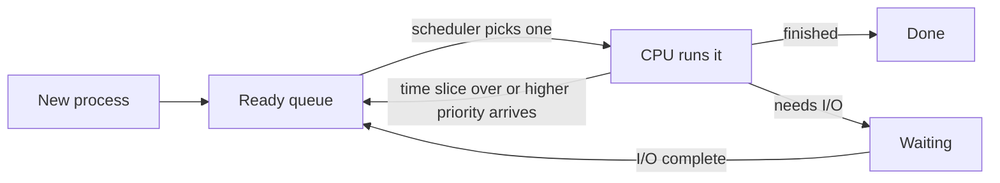

# CPU Scheduling Algorithms

## Diagram

## Explained in 5 lines
1. Many processes want the CPU, but only one runs at a time per core, so the OS **scheduler** decides who goes next.
2. **FCFS** (First Come First Served): simple, but one long job makes everyone wait (the *convoy effect*).
3. **SJF** (Shortest Job First): gives the lowest average waiting time, but long jobs can starve.
4. **Priority scheduling**: the highest priority runs first. Starvation is fixed with **aging** (waiting processes slowly gain priority).
5. **Round Robin**: each process gets a fixed *time quantum* in turn, which is fair and good for interactive systems. Too small a quantum wastes time on context switches.

## Common interview questions
- Preemptive vs non-preemptive scheduling?
- What is the convoy effect?
- Which algorithm gives minimum average waiting time?
- What is starvation and how does aging solve it?
- How does the time quantum affect Round Robin?
- Define turnaround time, waiting time and response time.

## Revision cheat-line
> FCFS = queue at a shop. SJF = shortest first. Priority = VIP first. Round Robin = everyone gets a turn.
