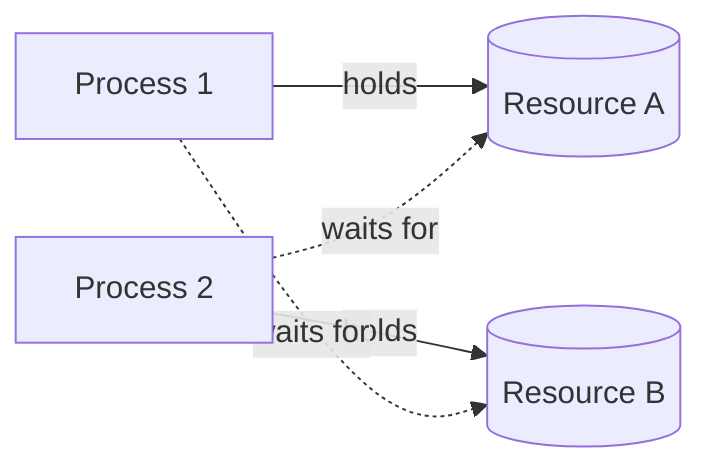

# Deadlock

## Diagram

## Explained in 5 lines
1. A **deadlock** happens when two or more processes wait for each other forever, and none can move ahead.
2. In the diagram, Process 1 holds A and wants B, while Process 2 holds B and wants A.
3. Deadlock needs **all four** conditions at once: Mutual Exclusion, Hold and Wait, No Preemption, Circular Wait.
4. To **prevent** it, break at least one condition (for example, make every process request resources in the same fixed order).
5. Operating systems can also avoid it (Banker's Algorithm), detect and recover from it, or simply ignore it (the "ostrich" approach used by many systems).

## Common interview questions
- What is a deadlock? Give a real-life example.
- What are the four necessary conditions for deadlock?
- How can deadlock be prevented, avoided, detected and recovered from?
- What is the Banker's Algorithm?
- What is the difference between deadlock and starvation?

## Revision cheat-line
> Deadlock = two people each holding one key and waiting for the other's key. Break any one of the 4 conditions and it can't happen.
