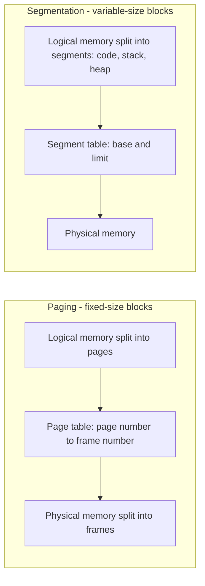

# Paging vs Segmentation

## Diagram

## Explained in 5 lines
1. Both are ways to map a program's addresses to real RAM without needing one big continuous block.
2. **Paging** cuts memory into equal fixed-size pieces (pages in logical memory, frames in physical memory). The OS keeps a page table to translate.
3. **Segmentation** cuts a program into logical parts of different sizes (code, data, stack), each with a base address and a limit.
4. Paging causes **internal fragmentation** (wasted space inside the last page). Segmentation causes **external fragmentation** (free memory broken into small unusable gaps).
5. Paging is invisible to the programmer. Segmentation matches how programmers think about a program.

## Common interview questions
- Difference between paging and segmentation?
- What is internal vs external fragmentation?
- What is a page table? What is a TLB?
- What is virtual memory and demand paging?
- What is a page fault?

## Revision cheat-line
> Paging = equal slices of a cake. Segmentation = slices cut by meaning (the icing, the sponge, the cherry).
