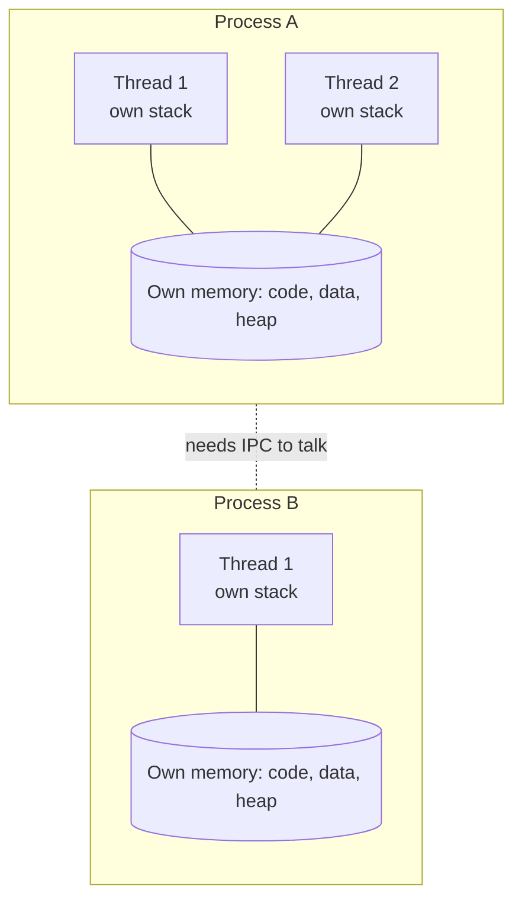

# Process vs Thread

## Diagram

## Explained in 5 lines
1. A **process** is a running program with its own private memory.
2. A **thread** is a smaller unit of work *inside* a process.
3. Threads of the same process **share** memory (heap, code, data) but each has its **own stack**.
4. Processes are isolated: one crashing doesn't usually crash another. They talk using IPC (pipes, sockets, shared memory).
5. Threads are cheaper to create and switch between, but shared memory means you must handle race conditions.

## Common interview questions
- What is the difference between a process and a thread?
- What do threads share, and what is private to each thread?
- Which is faster to context-switch, and why?
- What is a race condition? How do you avoid it?
- Can one thread crash the whole process?

## Revision cheat-line
> Process = isolated house. Threads = people living in the same house, sharing the kitchen.
