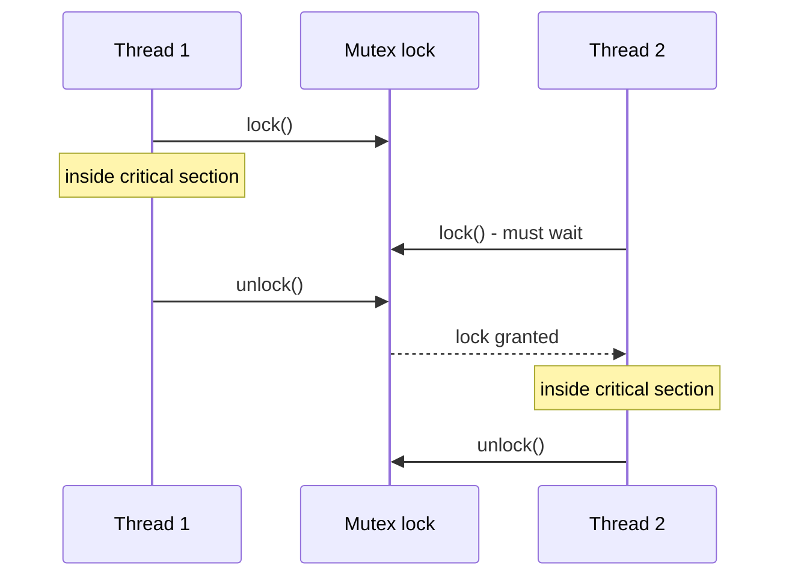

# Semaphore vs Mutex

## Diagram

## Explained in 5 lines
1. Both control access to shared resources so threads don't corrupt data (race conditions).
2. A **mutex** is a lock with *ownership*: only the thread that locked it can unlock it. It allows one thread at a time.
3. A **semaphore** is a counter. `wait()` decreases it and `signal()` increases it. If the count is 0, threads wait.
4. A **binary semaphore** (0 or 1) looks like a mutex, but has no ownership, so any thread can signal it.
5. A **counting semaphore** allows N threads at once, like a parking lot with N spaces.

## Common interview questions
- Difference between a mutex and a semaphore?
- What is a binary semaphore? Is it the same as a mutex?
- What is a critical section?
- What is the producer-consumer problem and how do semaphores solve it?
- What is a race condition?

## Revision cheat-line
> Mutex = one key to one room (the holder must return it). Semaphore = N tokens at a car park.
