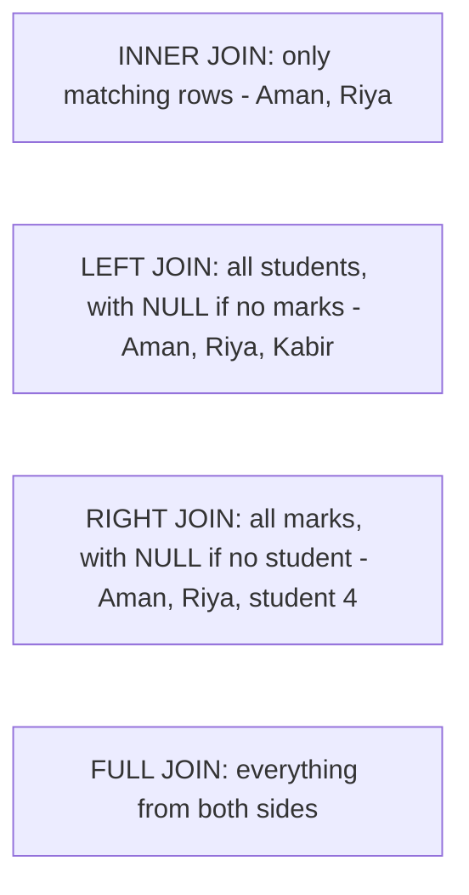

# SQL Joins, Visually

## Example tables
**students**

| id | name  |
|----|-------|
| 1  | Aman  |
| 2  | Riya  |
| 3  | Kabir |

**marks**

| student_id | score |
|-----------|-------|
| 1         | 80    |
| 2         | 90    |
| 4         | 70    |

(Kabir has no marks. Student 4 has marks but isn't in `students`.)

## Diagram


## Explained in 5 lines
1. A **JOIN** combines rows from two tables using a related column.
2. `INNER JOIN` keeps only rows that match in **both** tables.
3. `LEFT JOIN` keeps **all rows from the left table**, and fills the right side with `NULL` when there's no match.
4. `RIGHT JOIN` is the mirror image. `FULL JOIN` keeps all rows from both tables.
5. Example:

```sql
SELECT s.name, m.score
FROM students s
LEFT JOIN marks m ON s.id = m.student_id;
-- Aman 80, Riya 90, Kabir NULL
```

## Common interview questions
- Difference between INNER, LEFT, RIGHT and FULL joins?
- What is a self join? What is a cross join?
- How do you find rows in table A that have no match in table B? (`LEFT JOIN ... WHERE b.id IS NULL`)
- JOIN vs subquery?
- What is the difference between `WHERE` and `ON`?

## Revision cheat-line
> INNER = both. LEFT = all of the left. RIGHT = all of the right. FULL = everything.
