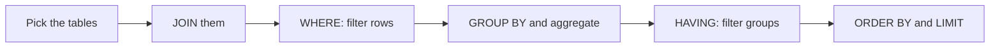

# Top 10 SQL Interview Queries

## Practice tables
`employees(id, name, salary, dept_id, manager_id)` , `departments(id, name)` , `customers(id, name)` , `orders(id, customer_id, amount, order_date)` , `users(id, email)`

## Diagram


## The 10 queries (MySQL/PostgreSQL style)

**1. Second highest salary**
```sql
SELECT MAX(salary) FROM employees
WHERE salary < (SELECT MAX(salary) FROM employees);
```

**2. Nth highest salary (here N = 3)**
```sql
SELECT DISTINCT salary FROM employees
ORDER BY salary DESC
LIMIT 1 OFFSET 2;   -- OFFSET = N - 1
```

**3. Find duplicate emails**
```sql
SELECT email, COUNT(*) FROM users
GROUP BY email HAVING COUNT(*) > 1;
```

**4. Delete duplicates, keeping the lowest id (MySQL)**
```sql
DELETE u1 FROM users u1
JOIN users u2 ON u1.email = u2.email AND u1.id > u2.id;
```

**5. Employees earning more than their manager**
```sql
SELECT e.name FROM employees e
JOIN employees m ON e.manager_id = m.id
WHERE e.salary > m.salary;
```

**6. Departments whose average salary is above 50000**
```sql
SELECT dept_id, AVG(salary) FROM employees
GROUP BY dept_id HAVING AVG(salary) > 50000;
```

**7. Departments with no employees**
```sql
SELECT d.name FROM departments d
LEFT JOIN employees e ON d.id = e.dept_id
WHERE e.id IS NULL;
```

**8. Highest-paid employee in each department**
```sql
SELECT * FROM (
  SELECT *, RANK() OVER (PARTITION BY dept_id ORDER BY salary DESC) AS rnk
  FROM employees
) t WHERE rnk = 1;
```

**9. Customers who never placed an order**
```sql
SELECT c.name FROM customers c
WHERE NOT EXISTS (SELECT 1 FROM orders o WHERE o.customer_id = c.id);
```

**10. Running total of order amounts**
```sql
SELECT order_date, amount,
       SUM(amount) OVER (ORDER BY order_date) AS running_total
FROM orders;
```

## Common interview questions
- RANK vs DENSE_RANK vs ROW_NUMBER?
- IN vs EXISTS?
- UNION vs UNION ALL?
- DELETE vs TRUNCATE vs DROP?
- How would you optimize a slow query?

## Revision cheat-line
> Most interview queries are just JOIN + GROUP BY + HAVING, or a window function. Practice those patterns.
